# StreamFlix Content Analytics

End-to-end streaming analytics project covering **data quality, exploratory analysis, KPI measurement, SQL analysis, Power BI dashboarding, and executive reporting** across nearly **979K records**.

> **Tools:** Python · Pandas · Matplotlib · Seaborn · SQL · Power BI · DAX

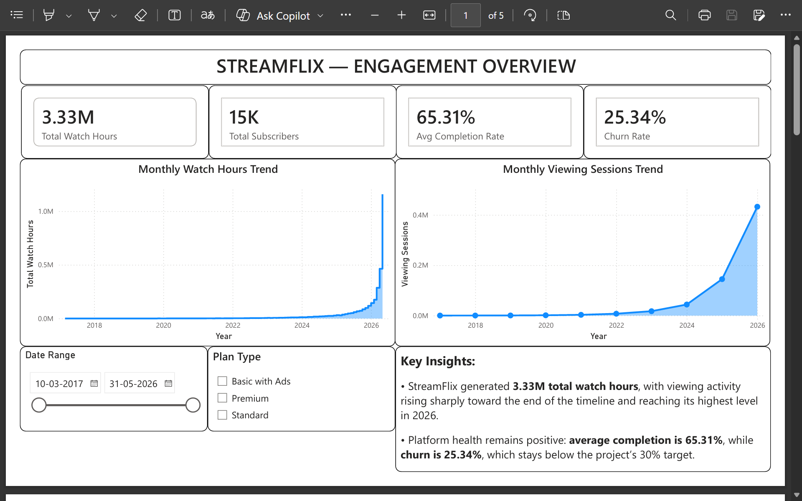

## Project Objective

StreamFlix wants to understand how subscribers use the platform, which content drives engagement, where churn and catalogue risk exist, and how future content investment can be prioritised.

This project answers questions such as:

- Which genres, titles and formats generate the most watch time?
- How healthy is the subscriber base?
- Which markets and devices drive engagement?
- Are viewers finishing content?
- How much recurring revenue is generated by active subscribers?
- How effectively do watchlists convert into viewing?
- How dependent is StreamFlix on licensed content?
- Which genres generate the strongest watch-time efficiency per $1K spent?

## Dataset

The analysis uses six interconnected datasets with **979,000 total records**.

| Table | Rows | Role |
|---|---:|---|
| Subscribers | 15,000 | Subscriber profile, plans, geography and churn |
| Titles | 9,000 | Catalogue, genres, licensing and investment |
| Watch History | 650,000 | Viewing sessions and completion |
| Ratings | 130,000 | 1–5 star ratings |
| Reviews | 110,000 | Reviews and sentiment |
| Watchlist | 65,000 | Saved titles and conversion |

Raw and cleaned CSVs are intentionally excluded from the public repository. See [data/README.md](data/README.md) for the expected local structure.

## Data Model

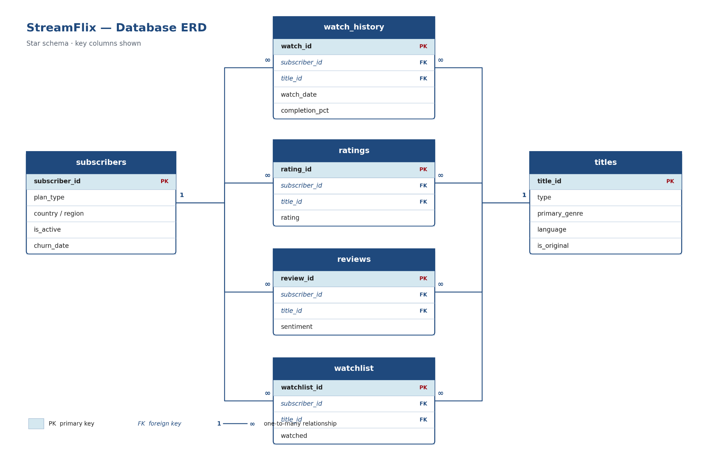

The model uses **Subscribers** and **Titles** as core dimensions, with Watch History as the central viewing fact table and Ratings, Reviews and Watchlist as related event tables.

## Project Workflow

### Phase 1 — Data Cleaning & Quality

Notebook: [Phase1_DataCleaning_KashifSiddique.ipynb](notebooks/Phase1_DataCleaning_KashifSiddique.ipynb)

Key checks included:

- dataset shape and data types
- missing values and duplicate rows
- primary-key uniqueness
- churn-date business rules
- viewing-duration outliers
- completion-percentage consistency
- review sentiment validation
- subscriber/title referential integrity
- catalogue consistency
- post-cleaning validation and clean-data export

### Phase 2 — Exploratory Data Analysis

Notebook: [Phase2_EDA_KashifSiddique.ipynb](notebooks/Phase2_EDA_KashifSiddique.ipynb)

Ten required EDA visuals were created and exported:

1. Monthly viewing volume
2. Monthly watch-hours trend
3. Genre-wise watch-hours share
4. Movies vs TV Shows
5. Top 10 subscriber countries by watch hours
6. Subscriber plan distribution
7. Device usage
8. Subscriber age distribution
9. Completion rate by genre
10. Review sentiment breakdown

<details>
<summary><b>View EDA charts</b></summary>

### Monthly Viewing Volume
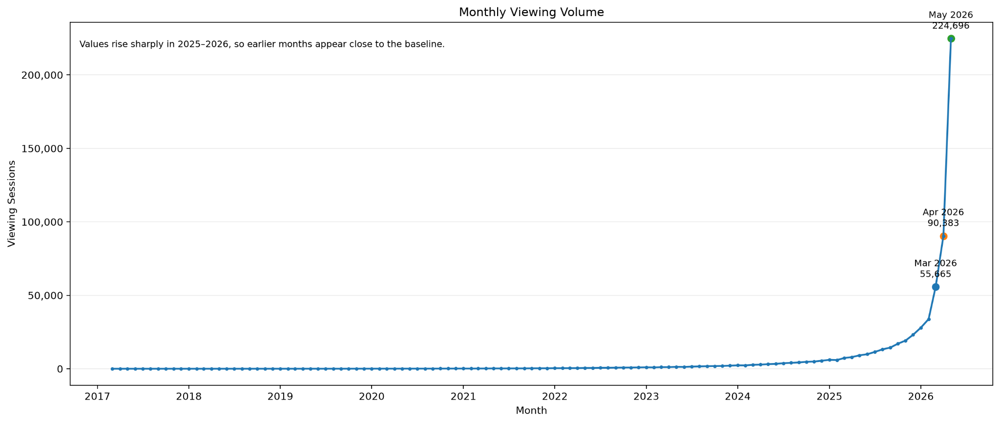

### Monthly Watch Hours
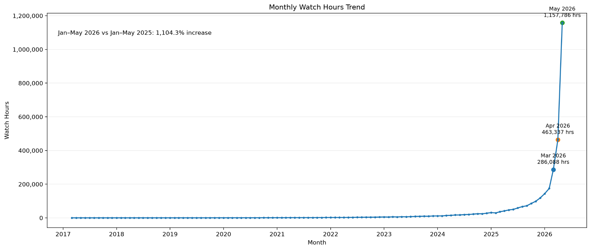

### Watch Hours by Genre
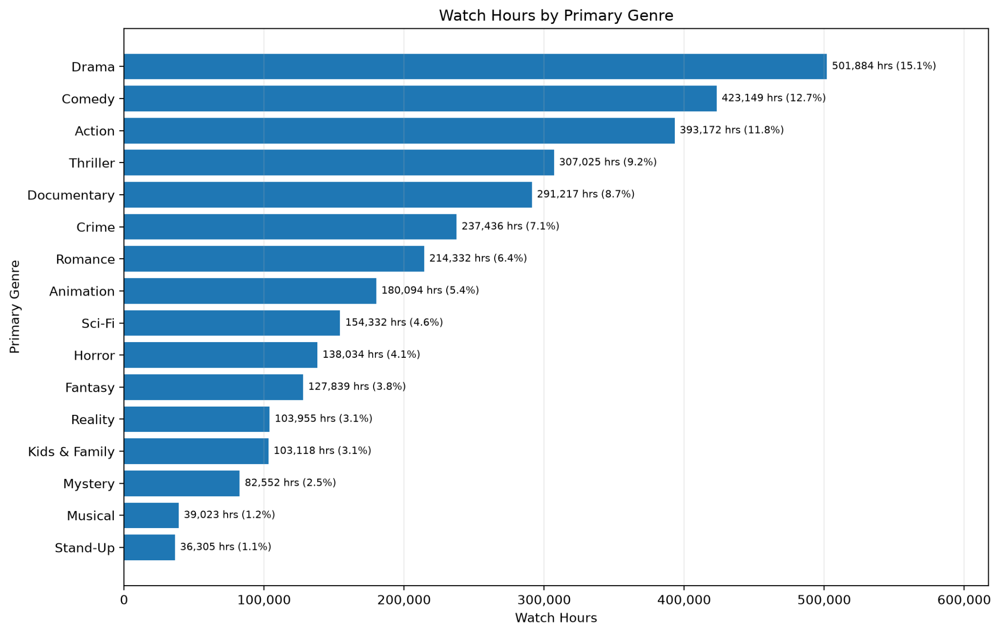

### Movies vs TV Shows
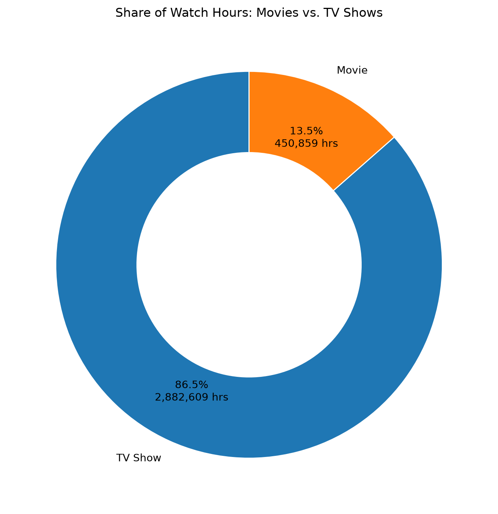

### Top Subscriber Countries
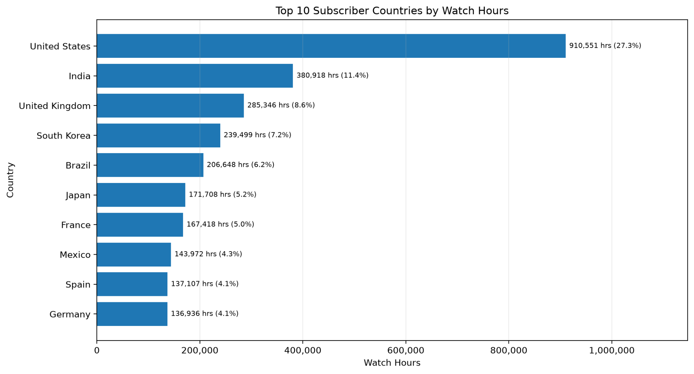

### Subscriber Plan Distribution
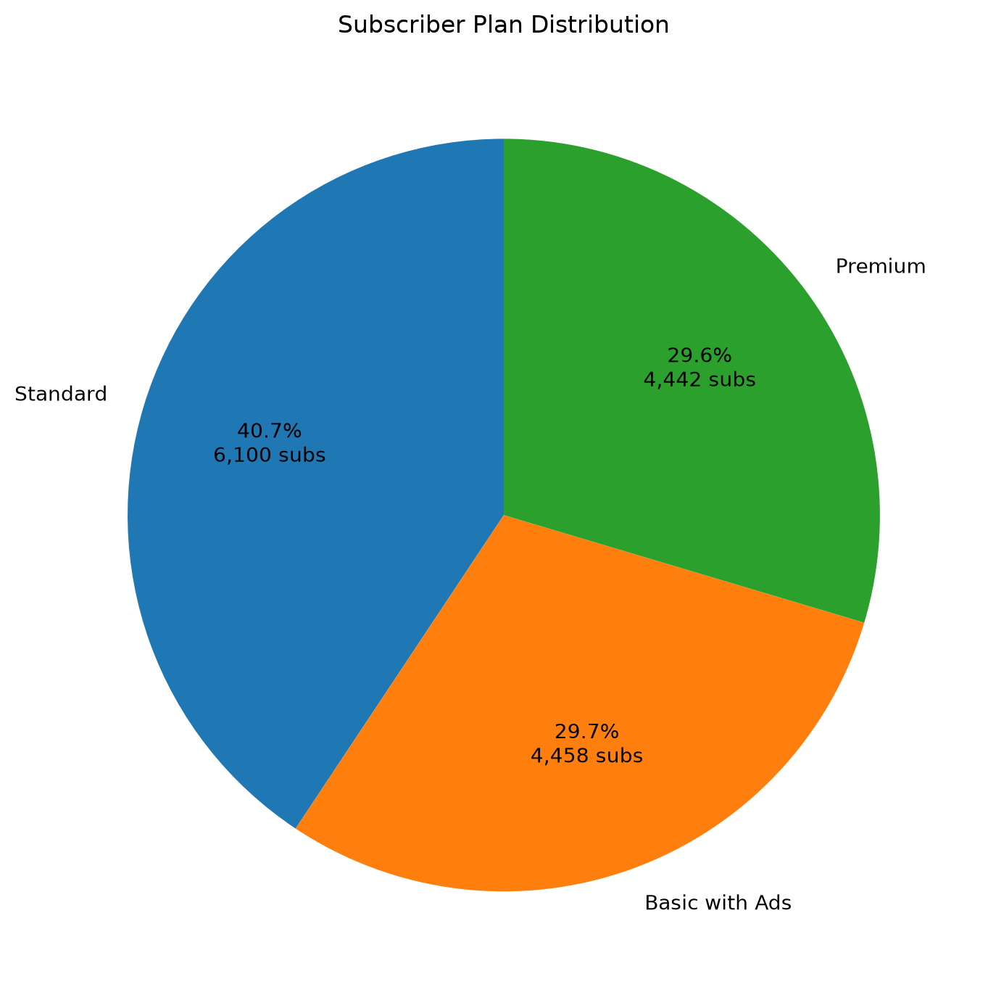

### Device Usage
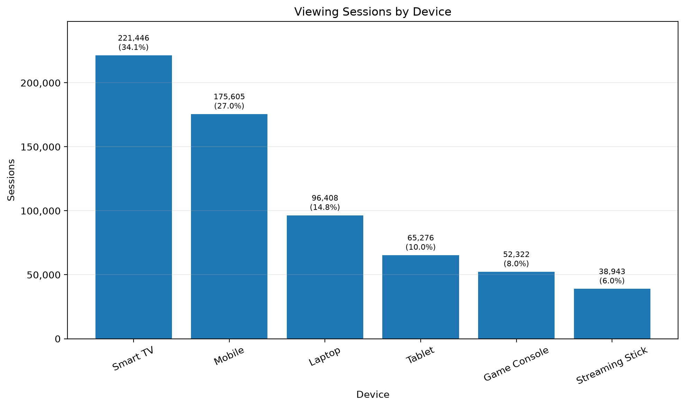

### Subscriber Age Distribution
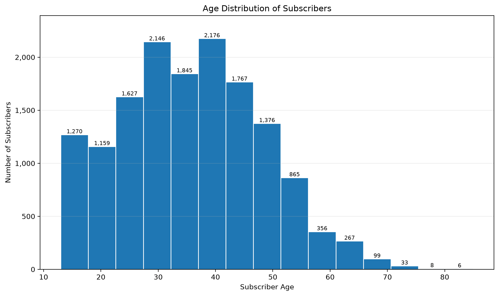

### Completion Rate by Genre
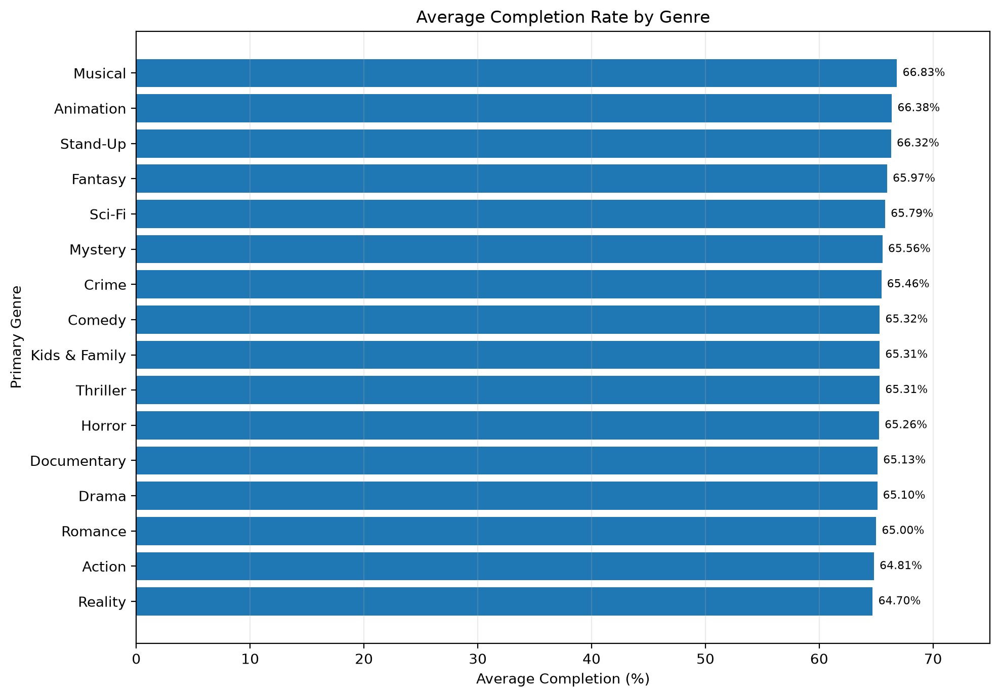

### Review Sentiment
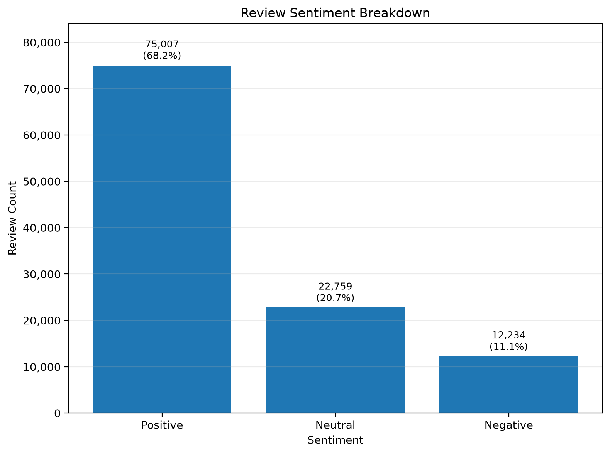

</details>

### Phase 3 — KPI Calculations

Notebook: [Phase3_KPIs_KashifSiddique.ipynb](notebooks/Phase3_KPIs_KashifSiddique.ipynb)

| KPI | Result |
|---|---:|
| Total Watch Hours | **3.33M** |
| Active Rate | **74.66%** |
| Churn Rate | **25.34%** |
| Average Completion Rate | **65.31%** |
| Monthly Recurring Revenue | **$175,868.51** |
| ARPU | **$15.70** |
| Average Watch Time / Active Subscriber | **297.66 hrs** |
| Watchlist Conversion | **46.23%** |
| Originals Share of Watch Hours | **27.17%** |

#### Bonus — Cohort Retention

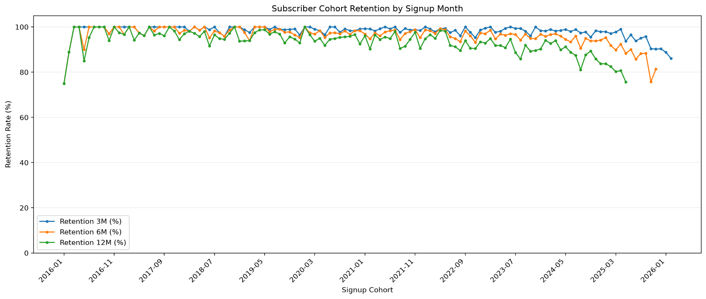

The optional cohort analysis tracks 3-, 6- and 12-month retention by signup cohort.

### SQL Analysis

SQL file: [StreamFlix_Analysis_Queries.sql](sql/StreamFlix_Analysis_Queries.sql)

The SQL work includes table schemas plus 12 analytical queries covering:

- genre performance
- content-origin markets
- release-year engagement
- Movies vs TV Shows
- language performance
- completion by genre
- subscriber-plan engagement
- device usage
- churn / active rate
- MRR / ARPU
- watchlist conversion
- content investment efficiency

## Phase 4 — Power BI Dashboard

Dashboard PDF: [Phase4_Dashboard_KashifSiddique.pdf](dashboard/Phase4_Dashboard_KashifSiddique.pdf)

The Power BI dashboard contains five pages.

### 1. Engagement Overview


### 2. Content Performance
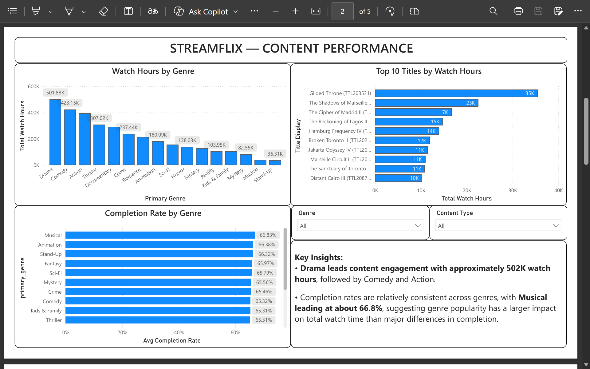

### 3. Subscriber Insights
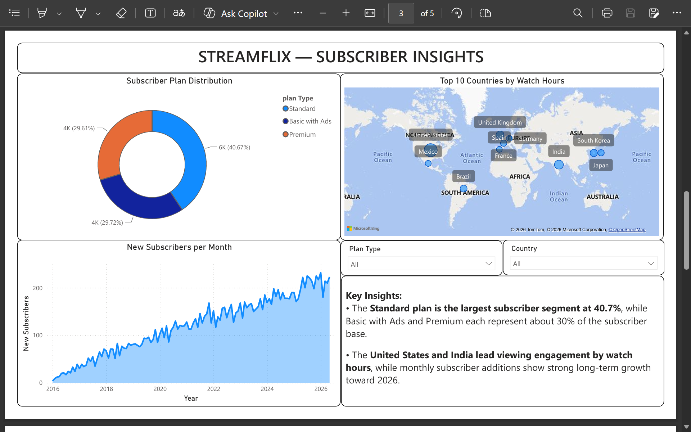

### 4. Experience
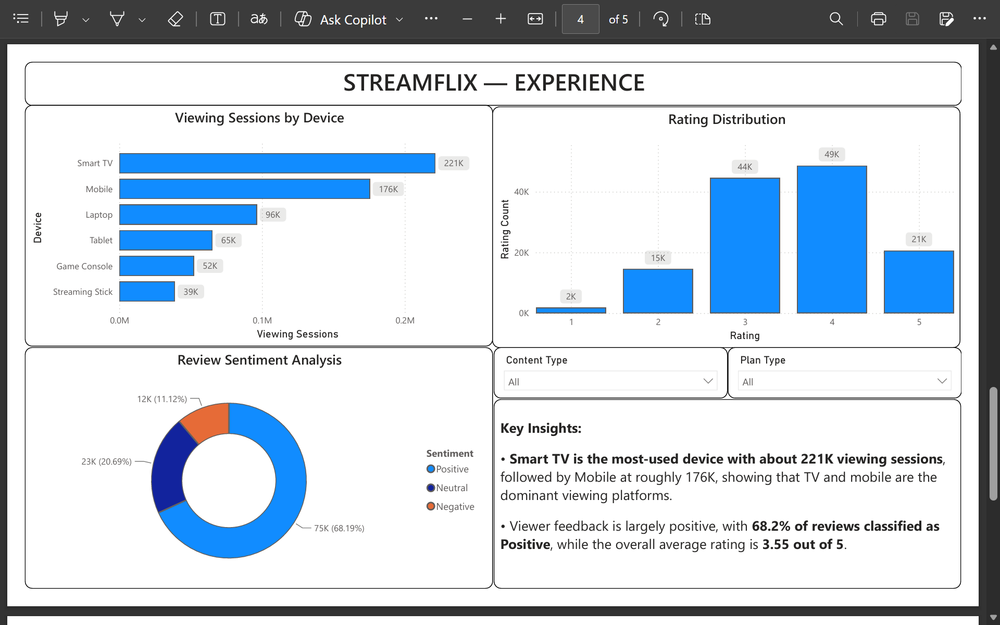

### 5. Catalogue & Investment
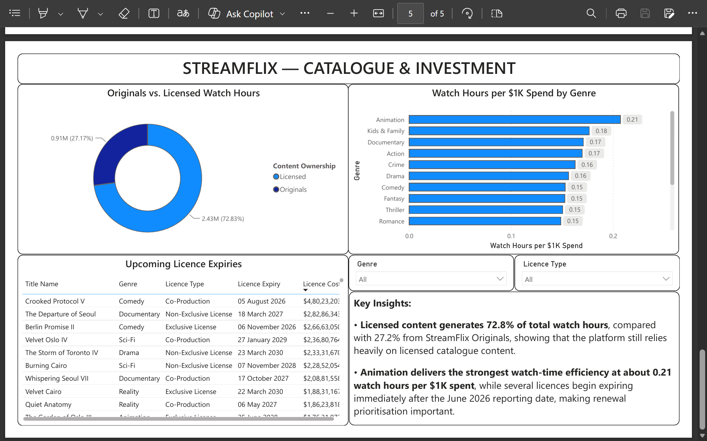

> The editable Power BI Desktop file is `Phase4_Dashboard_KashifSiddique.pbix`. GitHub permits the file size, but the connected upload interface used for this repository could not transfer the 20 MB binary. The PDF and all dashboard screenshots are included in the repository.

## Key Business Findings

1. **Engagement accelerated sharply into 2026.** Total watch time reached **3.33M hours**, with the strongest viewing activity appearing at the end of the observed period.

2. **Drama is the highest-engagement genre.** It generated about **502K watch hours**, followed by Comedy and Action.

3. **TV Shows dominate viewing.** They account for approximately **86.5% of watch hours**, making episodic content the platform's primary engagement driver.

4. **Subscriber health is above project thresholds.** Active rate is **74.66%**, churn is **25.34%**, and average completion is **65.31%**.

5. **The United States and India are the leading viewing markets.** The United States contributes roughly **27.3%** of watch hours.

6. **Smart TV and Mobile dominate device usage.** Together they account for more than **61% of viewing sessions**.

7. **Viewer sentiment is positive.** About **68.2%** of reviews are Positive and the overall average rating is **3.55 / 5**.

8. **StreamFlix is highly dependent on licensed content.** Licensed titles generate **72.83%** of watch hours versus **27.17%** from Originals.

9. **Animation leads content-investment efficiency**, generating about **0.21 watch hours per $1K spent**.

## Risks

- A **25.34% churn rate** is within the project threshold but still represents more than one quarter of subscribers.
- Heavy reliance on licensed content creates renewal-cost and availability risk.
- Investment efficiency varies materially across genres.
- More than half of watchlist entries still do not convert into viewing.

## Recommendations

1. **Reduce churn** with targeted retention actions for subscribers showing declining engagement.
2. **Rank licence renewals by business value** using watch hours, completion, audience size and investment efficiency.
3. **Invest selectively in Originals**, especially in categories with proven engagement.
4. **Prioritise Smart TV and Mobile experience** because these devices dominate sessions.
5. **Improve watchlist conversion** through personalised reminders and recommendation prompts.

## Management Report

The final CEO-focused report summarises platform health, top findings, risks, opportunities and recommendations:

[Download / View Phase4_Report_KashifSiddique.pdf](reports/Phase4_Report_KashifSiddique.pdf)

## Repository Structure

```text
StreamFlix-Content-Analytics/
├── README.md
├── requirements.txt
├── data/
│   └── README.md
├── notebooks/
│   ├── Phase1_DataCleaning_KashifSiddique.ipynb
│   ├── Phase2_EDA_KashifSiddique.ipynb
│   └── Phase3_KPIs_KashifSiddique.ipynb
├── sql/
│   └── StreamFlix_Analysis_Queries.sql
├── assets/
│   ├── eda/
│   ├── phase3/
│   └── dashboard/
├── dashboard/
│   └── Phase4_Dashboard_KashifSiddique.pdf
├── reports/
│   └── Phase4_Report_KashifSiddique.pdf
├── documentation/
│   ├── Project_Requirements.md
│   ├── Data_Dictionary.md
│   └── StreamFlix_ERD.png
└── .gitignore
```

## Skills Demonstrated

- Python data cleaning and validation
- Exploratory data analysis
- KPI design and business interpretation
- Cohort-retention analysis
- SQL joins, aggregations and business queries
- Power BI data modelling
- DAX measures
- Interactive dashboard design
- Executive reporting and recommendation development

## Author

**Kashif Siddique**  
Data Analyst Intern / Aspiring Data Analyst
